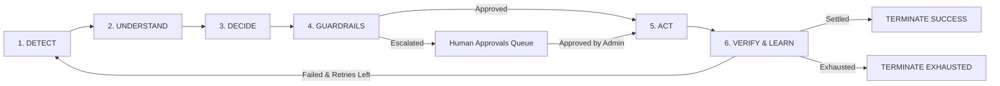
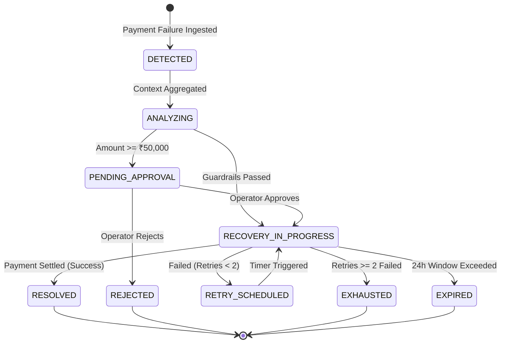

# ReviveAI — Deep System Architecture

This document provides a comprehensive technical breakdown of **ReviveAI**, detailing the autonomous agentic recovery loop, deterministic financial guardrails, state machine transitions, database schema, and interface design principles.

---

## 1. The Autonomous Agentic Recovery Loop

ReviveAI implements a 6-phase closed-loop operational lifecycle:

### Phase 1: DETECT
Payment failures from payment gateways (Razorpay, Stripe, UPI PSPs) are captured via webhook ingestion or direct event emitters. The failure payload contains error codes, raw gateway responses, transaction amounts, and customer IDs.

### Phase 2: UNDERSTAND (Context Enrichment)
The engine queries historical records to build a comprehensive contextual profile:
- **Customer Lifetime Value (LTV)**: High-tier vs standard customers.
- **Historical Success Count**: Number of prior settled transactions.
- **Failure Root Cause Taxonomy**:
  - `INSUFFICIENT_FUNDS`: Customer balance temporary shortfall.
  - `BANK_SERVER_DOWN` / `PSP_TIMEOUT`: Transient infrastructure outage.
  - `AUTH_FAILED` / `CARD_EXPIRED`: Authentication or credential expiration.
  - `MANDATE_TIMEOUT`: Subscription auto-debit friction.

### Phase 3: DECIDE (AI Structured Reasoning)
The engine generates a structured recovery plan using Gemini LLM structured outputs (or deterministic fallback heuristic):
- Recommended recovery strategy (`SMART_RETRY`, `ALTERNATIVE_GATEWAY`, `PAYMENT_LINK_SMS`, `PAYMENT_LINK_WHATSAPP`, `CUSTOMER_OUTREACH`).
- Execution delay in seconds (e.g. 180s for bank outages, 0s for dynamic routing).
- Confidence score (0.0 to 1.0).
- Explainable rationale citing specific customer metrics and cohort success rates.

### Phase 4: GUARDRAILS (Deterministic Financial Safety)
Before any action is scheduled or executed, it passes through the strict deterministic guardrails engine (`backend/app/guardrails.py`):
1. **Retry Limit ($\le 2$)**: Blocks any workflow attempting more than 2 retries to prevent customer spamming.
2. **High-Value Threshold ($\ge ₹50,000$)**: Automatically halts execution and creates an `ApprovalRequest` record for human operator sign-off.
3. **Time-to-Live (24 Hours)**: Bounded window after which workflows auto-expire.
4. **Idempotency**: Prevents concurrent duplicate actions on the same transaction.

### Phase 5: ACT & VERIFY
The orchestrator executes the validated action (dispatching payment link, routing to alternative gateway, or triggering smart retry) and records the execution timestamp.

### Phase 6: LEARN & AUDIT
Upon recovery, the workflow locks into `RESOLVED` state, records an immutable audit log, and updates cohort recovery telemetry for dashboard visualization.

---

## 2. State Machine Transitions

---

## 3. Database Schema & Data Models

ReviveAI utilizes SQLAlchemy models mapped to SQLite / PostgreSQL:

- **Customer**: `id`, `name`, `email`, `phone`, `tier`, `ltv_inr`, `successful_payments_count`, `risk_score`.
- **Payment**: `id`, `customer_id`, `amount_inr`, `currency`, `gateway`, `payment_method`, `status`, `error_code`, `error_message`, `created_at`.
- **PaymentEvent**: `id`, `payment_id`, `event_type`, `payload`, `created_at`.
- **RecoveryWorkflow**: `id`, `payment_id`, `status`, `strategy`, `current_retry_count`, `max_retries`, `requires_human_approval`, `ai_confidence`, `ai_reasoning`, `created_at`, `updated_at`.
- **RecoveryAction**: `id`, `workflow_id`, `action_type`, `channel`, `status`, `execution_delay_sec`, `executed_at`, `result_summary`.
- **ApprovalRequest**: `id`, `workflow_id`, `status`, `escalation_reason`, `requested_amount_inr`, `assigned_to`, `decided_at`, `notes`.
- **AuditLog**: `id`, `workflow_id`, `actor`, `action`, `previous_state`, `new_state`, `reason`, `metadata_json`, `created_at`.

---

## 4. API Endpoint Architecture

| Router | Endpoint | Description |
|---|---|---|
| **Dashboard** | `GET /api/dashboard/metrics` | Real-time aggregate KPIs (Revenue at Risk, Recovered, Recovery Rate) |
| **Dashboard** | `GET /api/dashboard/chart` | 7D / 30D / 90D timeline revenue series |
| **Incidents** | `GET /api/incidents` | Filterable incident ledger with status & error taxonomy |
| **Incidents** | `GET /api/incidents/{id}` | Deep forensic timeline, payload inspector & AI reasoning |
| **Incidents** | `POST /api/incidents/{id}/explain` | Real-time explainability breakdown with confidence evidence |
| **Recovery** | `GET /api/recovery/workflows` | Active recovery queue with live countdown timers |
| **Recovery** | `POST /api/recovery/trigger` | Autonomous or manual recovery trigger endpoint |
| **Approvals** | `GET /api/approvals` | High-value human-in-the-loop pending queue |
| **Approvals** | `POST /api/approvals/{id}/decide` | Approve or reject high-value recovery interventions |
| **Simulation** | `POST /api/simulation/run-scenario` | 10-step simulated payment failure & recovery scenario |
| **Audit** | `GET /api/audit` | Cryptographic immutable ledger of all operations and decisions |

---

## 5. Frontend Design System

Inspired by high-density financial command consoles:
- **Surface Palette**: `#0a0b0d` background, `#12151c` panels, `#1e2330` borders.
- **Accents**: Neon Cyan (`#06b6d4`), Emerald Green (`#10b981`), Amber (`#f59e0b`), Rose (`#f43f5e`).
- **Typography**: Inter (UI / Text) + JetBrains Mono (Financial amounts, transaction hashes, timestamps).
