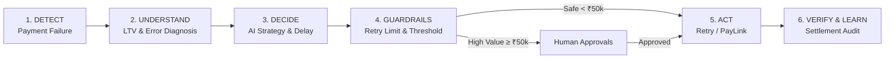

<div align="center">


# ⚡ ReviveAI — Autonomous AI Revenue Recovery Platform

[](https://github.com/MANOJHEGDE77/reviveai/actions)
[](https://reviveai-rcptftndp-kannimmhegde123-5360s-projects.vercel.app)
[](LICENSE)
[](https://python.org)
[](https://fastapi.tiangolo.com)
[](https://react.dev)
[](https://www.typescriptlang.org/)
[](https://tailwindcss.com/)
[](docker-compose.yml)

🌐 **Live Vercel Deployment**: [https://reviveai-rcptftndp-kannimmhegde123-5360s-projects.vercel.app](https://reviveai-rcptftndp-kannimmhegde123-5360s-projects.vercel.app)

**ReviveAI** is a production-grade autonomous revenue recovery system for merchants. It transforms passive payment monitoring into an active financial intelligence engine by implementing a closed-loop agentic lifecycle:

$$\mathbf{DETECT} \longrightarrow \mathbf{UNDERSTAND} \longrightarrow \mathbf{DECIDE} \longrightarrow \mathbf{ACT} \longrightarrow \mathbf{VERIFY} \longrightarrow \mathbf{LEARN}$$

</div>

---

## 📑 Table of Contents
- [Key Highlights](#-key-highlights)
- [Architecture & Agentic Loop](#-architecture--agentic-loop)
- [Deterministic Financial Guardrails](#-deterministic-financial-guardrails)
- [Tech Stack](#-tech-stack)
- [Project Structure](#-project-structure)
- [Quick Start Guide](#-quick-start-guide)
  - [1-Click Launch (Windows / Unix)](#1-click-local-development)
  - [Manual Setup](#manual-setup)
  - [Docker Setup](#docker-compose-deployment)
- [Interactive Command Center Flow](#-recommended-demo-flow)
- [API Reference](#-api-reference)
- [Automated Testing](#-automated-testing)
- [Documentation & Community](#-documentation--community)
- [License](#-license)

---

## 🚀 Key Highlights

1. **Closed-Loop Agentic Intelligence**: Detects payment failures in real-time, diagnoses root causes (network timeouts, balance shortfalls, mandate timeouts), selects the optimal recovery strategy, and executes bounded actions.
2. **Deterministic Financial Safety Guardrails**:
   - **Retry Limit**: Strictly capped at $\le 2$ autonomous retry attempts.
   - **High-Value Governance Threshold**: Any recovery action on transactions $\ge ₹50,000$ mandates human sign-off via the `/approvals` queue.
   - **Recovery Window**: 24-hour bounded window to prevent delayed settlement disputes.
   - **Idempotency & Auto-Termination**: Automatically terminates recovery workflows upon payment settlement.
3. **Explainable AI Reasoning**: Every decision is accompanied by a transparent breakdown citing customer lifetime value (LTV), historical successful transaction counts, and cohort recovery rates.
4. **Interactive Simulation Lab**: Includes an evaluator test bench to simulate real payment failure scenarios (card throttles, checkout drop-offs, subscription mandate failures, UPI PSP timeouts).
5. **Fintech Operations Console**: High-density interface inspired by Stripe and Linear, featuring dark charcoal surfaces, live telemetry tickers, and JetBrains Mono financial typography.

---

## 🏗 Architecture & Agentic Loop



> For deep architectural specifications, see [ARCHITECTURE.md](ARCHITECTURE.md).

---

## 🛡 Deterministic Financial Guardrails

| Guardrail Rule | Parameter | Purpose |
|---|---|---|
| **Max Retry Limit** | $\le 2$ Attempts | Protects customer trust and prevents payment spamming |
| **Approval Escalation** | $\ge ₹50,000$ INR | Mandates human operator confirmation for high-value transactions |
| **Max Recovery Window** | 24 Hours | Bounds recovery actions within acceptable banking settlement windows |
| **Auto-Termination** | Instant on Success | Automatically terminates workflows and locks state to prevent double charges |
| **Notification Cap** | $\le 1$ Outreach | Restricts merchant outreach to avoid customer fatigue |

---

## 🛠 Tech Stack

- **Backend**: Python 3.12+ / 3.13, FastAPI, SQLAlchemy 2.0, Pydantic v2, Uvicorn, SQLite / PostgreSQL.
- **AI Agent**: Gemini API structured JSON schema generation + deterministic heuristic fallback.
- **Frontend**: React 18, Vite, TypeScript, Tailwind CSS, Recharts, Lucide React.
- **Testing & CI**: Pytest, Pytest-Asyncio, GitHub Actions.
- **Deployment**: Docker & Docker Compose.

---

## 📁 Project Structure

```
reviveai/
├── .github/
│   ├── workflows/ci.yml        # GitHub Actions automated test & build pipeline
│   ├── ISSUE_TEMPLATE/         # Bug report & Feature request templates
│   └── pull_request_template.md # PR submission checklist
├── backend/
│   ├── app/
│   │   ├── main.py             # FastAPI entrypoint, lifespan seeder, CORS, routers
│   │   ├── config.py           # Guardrails & API configuration
│   │   ├── database.py         # SQLAlchemy engine & session management
│   │   ├── models.py           # Customer, Payment, RecoveryWorkflow, AuditLog models
│   │   ├── schemas.py          # Pydantic validation schemas & AI structured output
│   │   ├── guardrails.py       # Deterministic safety bounds engine
│   │   ├── ai_agent.py         # Gemini LLM structured reasoner + heuristic fallback
│   │   ├── recovery_engine.py  # Closed-loop orchestrator & state machine
│   │   ├── seeder.py           # Realistic Indian fintech merchant seed baseline
│   │   └── routers/            # Clean REST API endpoints (dashboard, incidents, recovery, etc.)
│   ├── tests/
│   │   ├── test_engine.py      # Automated unit tests for guardrails & state transitions
│   │   └── test_api_endpoints.py # End-to-end API integration tests
│   ├── test_qa_suite.py        # 9-Stage production QA audit test suite
│   ├── requirements.txt
│   └── Dockerfile
├── frontend/
│   ├── src/
│   │   ├── api/client.ts       # Typed Axios API client & Indian currency formatters
│   │   ├── types/index.ts      # TypeScript interfaces
│   │   ├── components/         # Layout, LiveAiOperations, DecisionExplainer, Toast
│   │   └── pages/              # Dashboard, Incidents, Recovery, Approvals, Audit, Simulation
│   ├── package.json
│   ├── vite.config.ts
│   └── Dockerfile
├── .env.example
├── .gitignore
├── ARCHITECTURE.md
├── CONTRIBUTING.md
├── docker-compose.yml
├── LICENSE
├── README.md
├── SECURITY.md
├── start-dev.bat               # 1-Click Windows development launcher
└── start-dev.sh                # 1-Click Unix development launcher
```

---

## ⚡ Quick Start Guide

### 1-Click Local Development

#### Windows
Double click or run `start-dev.bat`:
```cmd
start-dev.bat
```

#### macOS / Linux
Run `start-dev.sh`:
```bash
chmod +x start-dev.sh
./start-dev.sh
```

---

### Manual Setup

#### 1. Backend Setup
```bash
cd backend
python -m venv .venv

# On Windows:
.venv\Scripts\activate
# On macOS/Linux:
source .venv/bin/activate

pip install -r requirements.txt
python -m uvicorn app.main:app --port 8000 --host 127.0.0.1 --reload
```
- API & Interactive Swagger Docs: `http://127.0.0.1:8000/docs`

#### 2. Frontend Setup
```bash
cd frontend
npm install
npm run dev
```
- Frontend Application: `http://127.0.0.1:5173/`

---

### Docker Compose Deployment

```bash
docker-compose up --build
```
- Frontend accessible at: `http://localhost:5173`
- Backend API accessible at: `http://localhost:8000`

---

## 🎬 Recommended Demo Flow

1. **Landing Page (`/`)**: Explore the interactive 4-step recovery animation. Click **Launch Command Center**.
2. **Command Center (`/dashboard`)**:
   - Inspect real-time metrics: **₹4.82L Revenue at Risk**, **₹2.91L Recoverable**, **₹1.47L Recovered**, **42.8% Recovery Rate**.
   - Review the **7D/30D/90D Revenue Intelligence Area Chart** and **Revenue Risk Map**.
3. **Simulation Lab (`/simulation`)**:
   - Click **Start Autonomous Scenario** in the 1-Click Verification card.
   - Watch the 10-step autonomous loop execute in real-time.
4. **Incident Center (`/incidents`)**:
   - Inspect the incident ledger. Click any incident to open **Incident Forensics (`/incidents/:id`)**.
   - Click **Explain AI Decision** to view the explainability modal with confidence score and evidence data points.
5. **Human Approvals (`/approvals`)**:
   - Inspect high-value transactions ($\ge ₹50,000$) escalated to the human operator queue. Click **Approve** or **Reject**.
6. **Audit Ledger (`/audit`)**:
   - Filter by actor and inspect the immutable chronological trail of decisions, reasons, guardrail checks, and outcomes.

---

## 📡 API Reference

| Endpoint | Method | Description |
|---|---|---|
| `/api/dashboard/summary` | `GET` | Retrieve aggregate financial KPIs, recovery rate, and 7-day trajectory |
| `/api/incidents` | `POST` | Ingest custom payment failure with real customer data & evaluate guardrails |
| `/api/incidents` | `GET` | List payment failure incidents with filters |
| `/api/incidents/{id}` | `GET` | Get forensic detail, error codes, and audit events |
| `/api/incidents/{id}/explain` | `POST` | Generate explainable AI decision reasoning breakdown |
| `/api/approvals` | `GET` | List pending high-value approval requests |
| `/api/approvals/{id}/decision` | `POST` | Approve or reject a high-value recovery workflow |
| `/api/simulation/trigger` | `POST` | Ingest custom scenario event and execute autonomous loop |
| `/api/simulation/demo-scenario` | `POST` | Execute end-to-end simulated failure & recovery scenario |
| `/api/audit` | `GET` | Access cryptographic-grade immutable audit ledger |

---

## 🧪 Automated Testing

```bash
# Run all 24 unit & integration tests from project root
pytest -v

# Run the standalone production QA audit test suite
python backend/test_qa_suite.py
```

Automated tests verify:
- Real custom user input ingestion with custom customer identity, amounts, and LTV.
- Guardrail rejection when retry limits are exceeded ($\le 2$).
- High-value transaction escalation into approval requests ($\ge ₹50,000$).
- State machine auto-termination upon payment success.
- AI structured schema parsing and safe deterministic fallbacks.
- End-to-end 9-stage revenue recovery lifecycle simulation.

---

## 📚 Documentation & Community

- [Architecture & Deep Design](ARCHITECTURE.md)
- [Cloud & Vercel Deployment Guide](DEPLOYMENT.md)
- [Contributing Guidelines](CONTRIBUTING.md)
- [Security Policy](SECURITY.md)
- [Code of Conduct](CODE_OF_CONDUCT.md)

---

## 📄 License

This project is licensed under the MIT License - see the [LICENSE](LICENSE) file for details.
